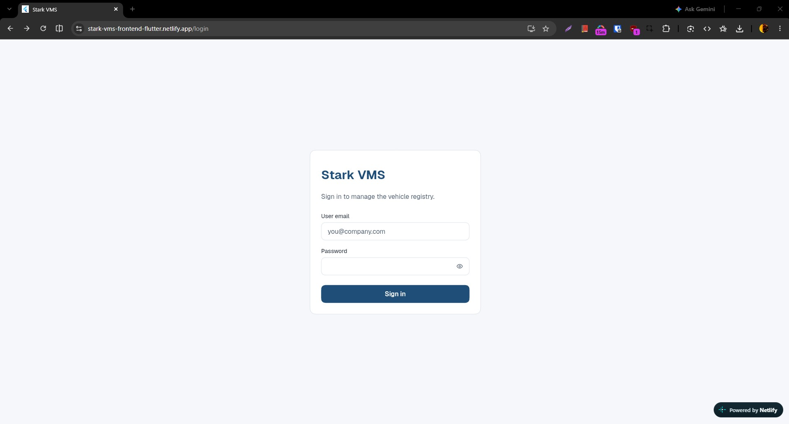
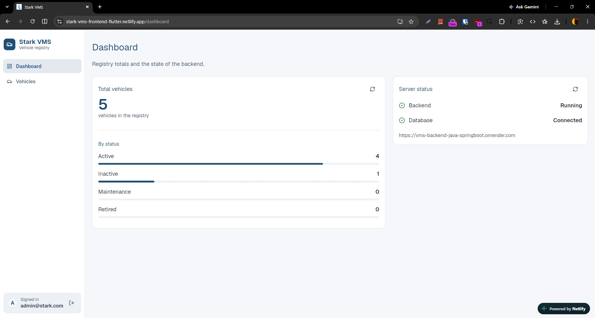
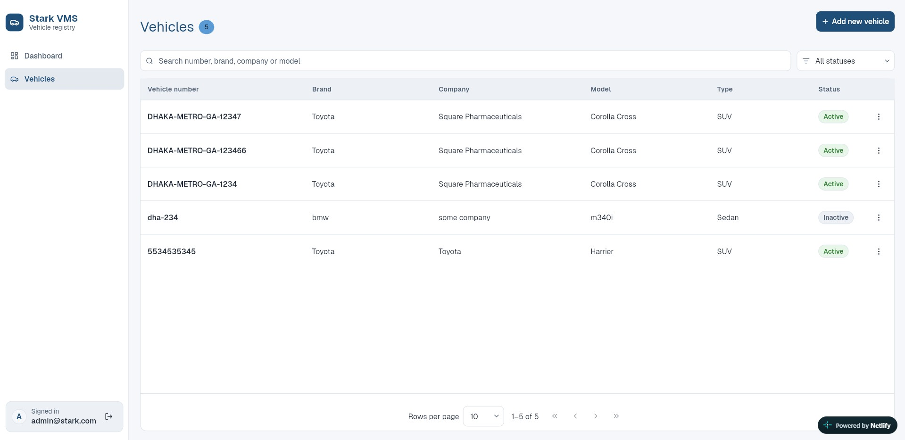
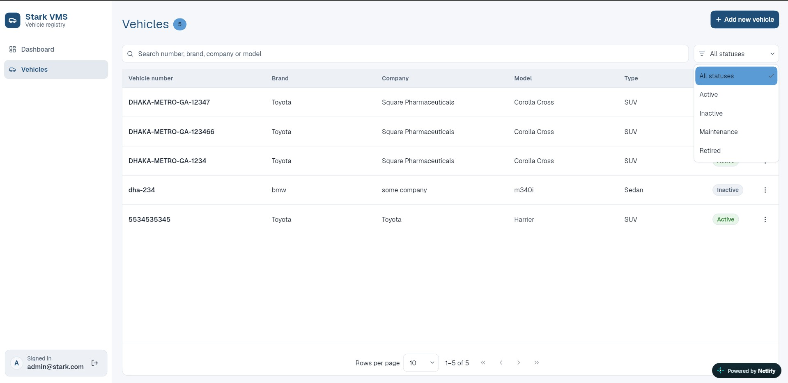
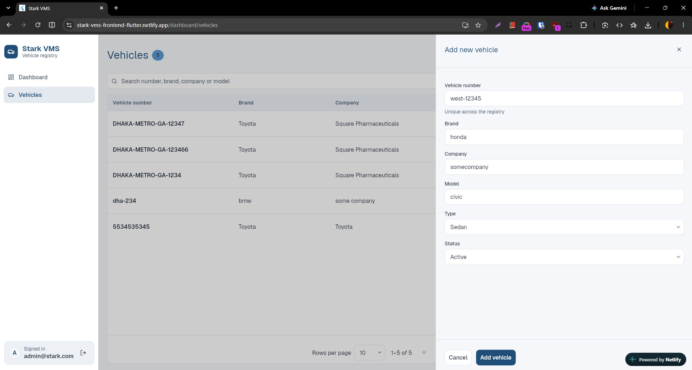
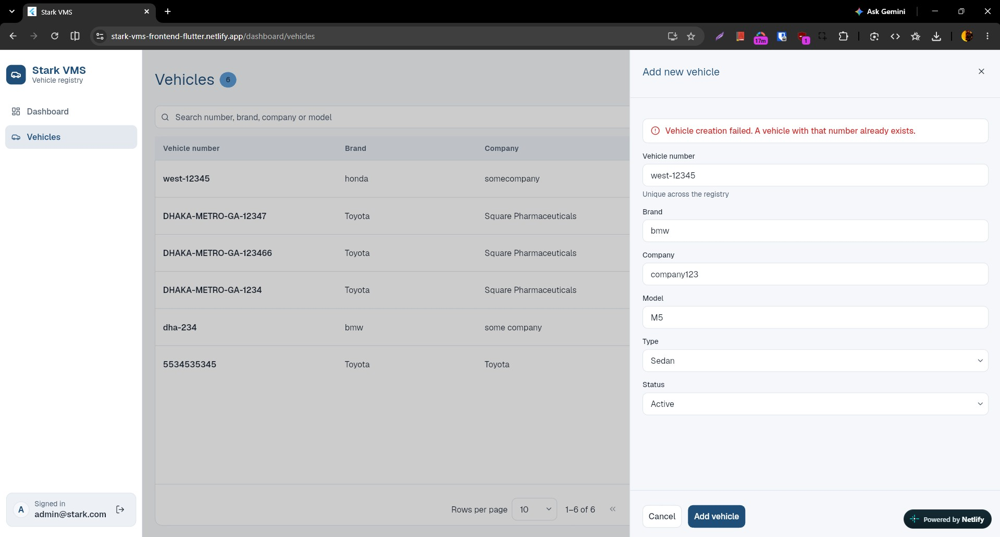
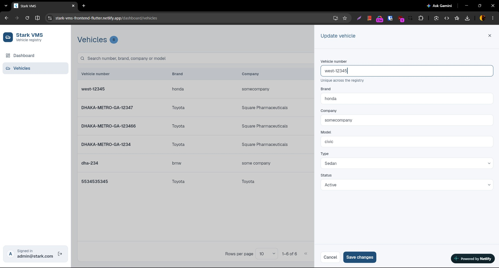
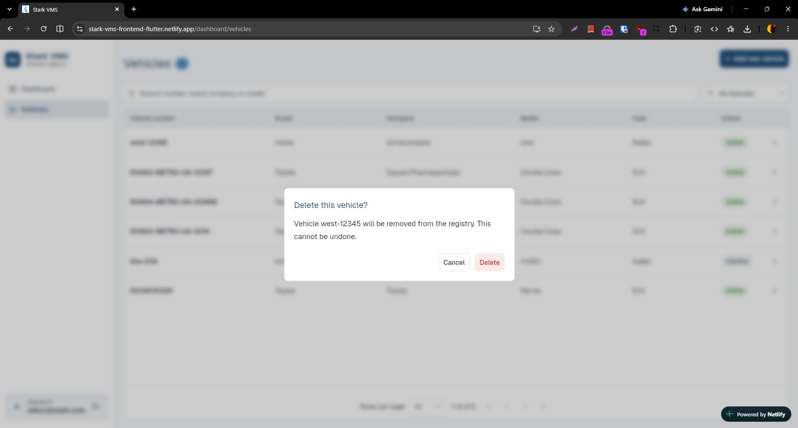
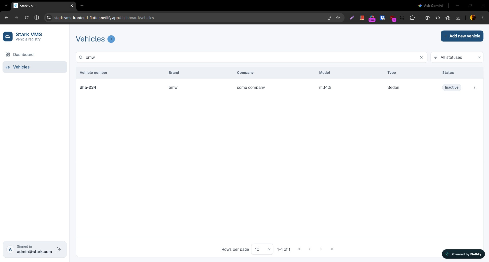
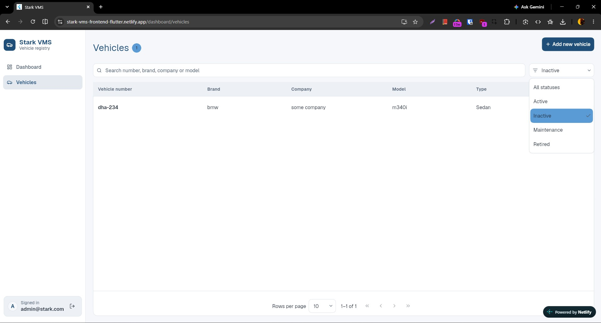

## View Full Documentation: [github.com/AhmadZubayer/vms-backend-java-springboot/blob/main/README.md](https://github.com/AhmadZubayer/vms-backend-java-springboot/blob/main/README.md)

## 1. Introduction

A small web app for keeping track of a company's vehicles. An operator signs in,
sees how many vehicles there are and what state they are in, and adds, edits,
searches or deletes them. This repository is the frontend: a Flutter web app
that talks to the Spring Boot API over a PostgreSQL database.

### 1.1 User journey

Open app → sign in with email and password → land on dashboard → read total
vehicles, status counts and server health → open Vehicles.

Search or filter by status → add a vehicle, or use the row menu to update or
delete one → confirm → table and counts refresh → log out.

## 2. Links

| What                  | Where                                                                           |
| --------------------- | ------------------------------------------------------------------------------- |
| Deployed app          | https://stark-vms-frontend-flutter.netlify.app                                  |
| Backend API           | https://vms-backend-java-springboot.onrender.com                                |
| API docs (Swagger UI) | https://vms-backend-java-springboot.onrender.com/docs                           |
| GitHub, backend       | https://github.com/AhmadZubayer/vms-backend-java-springboot                     |
| GitHub, frontend      | https://github.com/AhmadZubayer/vms-frontend-flutter-web                        |
| Project documentation | https://github.com/AhmadZubayer/vms-backend-java-springboot/blob/main/README.md |

## 3. Screenshots

**1. Sign in**



**2. Dashboard, registry totals and server status**



**3. Vehicle list**



**4. Status filter**



**5. Add new vehicle**



**6. Duplicate vehicle number is refused**



**7. Update vehicle**



**8. Delete confirmation**



**9. Search**



**10. Filter by status**


## 4. Folder and file structure

```
vms_frontend_flutter/
├── app_config.env                    API URL read at start-up, gitignored
├── app_config.env.example            copy this to app_config.env
├── netlify.toml                      build command, SPA rewrite, headers
├── pubspec.yaml                      dependencies, fonts, the env asset
├── analysis_options.yaml             lint rules
├── README.md                         this document
├── screenshots/                      the images above
├── scripts/
│   └── netlify_build.sh              fetches Flutter, writes the env, builds
├── assets/
│   └── fonts/                        Geist, bundled with the app
├── web/
│   ├── index.html                    page shell
│   ├── _redirects                    every path falls back to index.html
│   ├── _headers                      security and cache headers
│   ├── manifest.json, favicon.png, icons/
├── test/
│   └── forui_migration_test.dart
└── lib/
    ├── main.dart                     loads the config, then runs the app
    ├── app/
    │   ├── app.dart                  MaterialApp, splash while restoring
    │   ├── router.dart               go_router, redirects by session
    │   ├── routes.dart               every path in one place
    │   ├── theme.dart                forui theme, colours and typography
    │   └── config_error_app.dart     shown when API_BASE_URL is missing
    ├── core/
    │   ├── config/app_config.dart    reads app_config.env
    │   ├── network/
    │   │   ├── api_client.dart       Dio, bearer token, data unwrapping
    │   │   ├── api_exception.dart    reads the failure envelope
    │   │   └── session_events.dart   carries 401 to the auth layer
    │   ├── platform/url_strategy*.dart  path URLs on the web only
    │   ├── storage/token_storage.dart   the access token
    │   └── widgets/
    │       ├── app_toast.dart        top-centre toasts
    │       ├── confirm_dialog.dart   delete confirmation
    │       ├── responsive_sheet.dart right sheet, bottom on mobile
    │       └── state_views.dart      loading, error and empty states
    └── features/
        ├── auth/
        │   ├── data/auth_repository.dart
        │   ├── domain/auth_state.dart, auth_user.dart
        │   └── presentation/auth_controller.dart, login_page.dart
        ├── dashboard/
        │   ├── data/health_repository.dart
        │   ├── domain/server_health.dart
        │   └── presentation/
        │       ├── dashboard_shell.dart     side menu frame
        │       ├── overview_page.dart       the two cards
        │       └── widgets/side_menu.dart, vehicle_totals_card.dart,
        │                   server_status_card.dart
        ├── vehicles/
        │   ├── data/vehicles_repository.dart
        │   ├── domain/vehicle.dart, vehicle_status.dart, vehicle_type.dart,
        │   │          paged_result.dart, vehicle_stats.dart
        │   └── presentation/
        │       ├── vehicles_controller.dart  query, page, mutations
        │       ├── vehicles_page.dart        header, table, pager
        │       └── widgets/vehicles_table.dart, vehicle_form_sheet.dart,
        │                   pagination_bar.dart, status_chip.dart
        └── errors/
            └── presentation/not_found_page.dart, unauthorized_page.dart,
                             error_page_scaffold.dart
```
